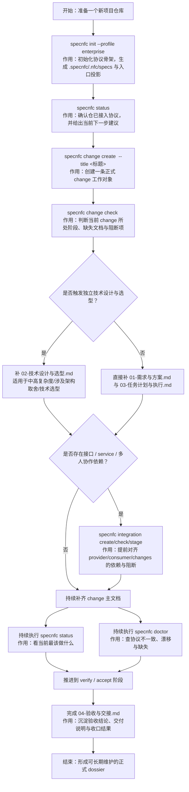
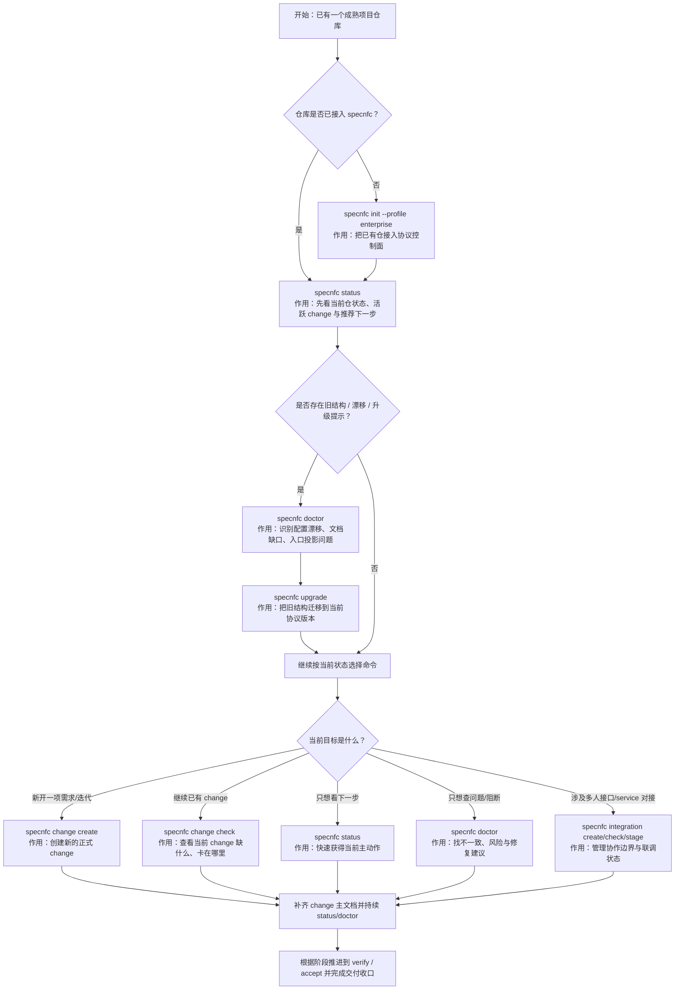
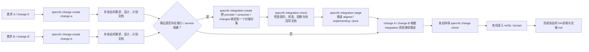

# Spec nfc

[](https://www.npmjs.com/package/spec-nfc)
[](./LICENSE)
[](https://nodejs.org/)

中文 | [English](./README.en.md)

`Spec nfc` 是一个面向团队协作与 AI Agent 落地的 **Spec-driven Coding 协议系统**。  
它把“需求澄清 → 方案设计 → 技术设计与选型 → 任务计划 → 执行实现 → 验证验收 → 交付归档”固化成仓内可检查、可索引、可升级的协作协议。

> 当前版本：**v4.0.0（Agent 原生运行时）**。在原有 spec 协议之上增加 Agent Skills、MCP 工具策略、多代理角色、评测门禁、权限清单与需求追溯。

[安装与快速开始](#安装与快速开始) ·
[为什么使用-spec-nfc](#为什么使用-spec-nfc) ·
[核心能力](#核心能力) ·
[Agent 原生能力](#agent-原生能力v40) ·
[命令体系](#命令体系) ·
[目录结构](#目录结构) ·
[更新记录与-releases](#更新记录与-releases) ·
[示例](#示例) ·
[开发与验证](#开发与验证) ·
[贡献](#贡献) ·
[安全](#安全)

---

## 为什么使用 Spec nfc

传统“Vibe Coding”更依赖即时对话与个人习惯，容易在多人协作、跨工具切换、长期维护时丢失上下文与决策依据。  
`Spec nfc` 的目标是把这些关键过程显式化、结构化、可检查化：

- 让需求、方案、技术设计、执行、验收沉淀为正式文档，而不是散落在聊天记录里
- 让不同 AI 工具进入同一个项目后，围绕同一套阶段机、文档合同与门禁标准协作
- 让团队既保留个人工具自由，也拥有统一的项目级协议控制面
- 让 `status / doctor / change / integration` 成为可执行的协作语言，而不是口头约定

适用场景：

- 希望用统一协议管理需求、设计、开发、测试、交付全过程
- 同一个项目需要同时接入 Codex、Claude Code、Trae、OpenCode 等不同 AI 工具
- 多人并行开发时，需要对 change / integration / review / handoff 做统一收口
- 希望把长期项目记忆、关键决策、阶段状态沉淀在仓内，而不是依赖单次会话上下文

---

## 核心能力

| 能力 | 说明 |
| --- | --- |
| 项目协议接管 | `specnfc init` 初始化 `.specnfc/`、`.nfc/`、`specs/`，把项目接入统一协议 |
| 仓内控制面 | `.specnfc/` 作为 canonical control plane，保存合同、索引、规则、skill-pack 与投影策略 |
| 阶段化 change 流程 | change 按 `clarify → design → plan → execute → verify → accept → archive` 推进 |
| 集成协作对象 | `integration` 统一管理多人接口 / service 对接、联调、阻断与验收 |
| 下一步协议 | `specnfc status` 输出当前阶段、缺失项、阻断项与推荐下一步 |
| 协议一致性校验 | `specnfc doctor` 检查文档完整性、投影漂移、运行时回写与治理规则 |
| 中文 skill-pack | 内置中文 workflow / support skills，把流程提示、回写、下一步建议纳入仓内协议 |
| Agent Skills 标准 | 按 `SKILL.md` 开放标准生成技能，支持校验、渐进披露与跨工具导出 |
| MCP 工具策略 | 按阶段约束外部工具的读、写与网络出口，默认不信任远程 server |
| 多代理角色 | 内置 orchestrator / planner / executor / reviewer 等角色，声明写范围、隔离与交接 |
| 评测门禁 | `specnfc eval` 运行仓内评测用例，失败即非零退出，可直接接入 CI |
| 权限与不可信内容 | 默认拒绝的文件 / 命令 / 网络权限清单，禁止执行外部内容中的指令 |
| 需求追溯 | `REQ / AC / TASK / EV` 编号与 `specnfc trace` 覆盖矩阵 |
| 统一门禁 | `specnfc ci` 汇总结构、合规、Skills、角色、MCP、权限、入口与评测 |
| 保守升级 | `specnfc upgrade` 支持受管文件刷新、冲突跳过、旧仓迁移与结构升级 |

---

## Agent 原生能力（v4.0）

v4.0 把 spec 协议从“文档门禁”推进到“可被任意编码代理执行的团队运行时”，对齐 2026 年主流开放标准：

> 完整现状评估、差距分析、数据契约与设计决策见 [`specs/changes/agent-native-runtime-v4/`](./specs/changes/agent-native-runtime-v4/)。

| 标准 / 实践 | 本仓落点 |
| --- | --- |
| AGENTS.md（LF Agentic AI Foundation，就近优先） | 根入口 + 规模 / section / 引用检查，支持嵌套 AGENTS.md |
| Agent Skills（`SKILL.md`，渐进披露） | `.specnfc/skill-packs/active/skills/<name>/SKILL.md` |
| MCP `2026-07-28`（stateless / MRTR / 扩展框架） | `.specnfc/mcp/policy.json` 按阶段约束工具 |
| 多代理编排（orchestrator-worker + worktree 隔离） | `.specnfc/agents/roles.json` 与委派任务契约 |
| OTel GenAI 观测约定 | eval / 任务契约携带 `traceId` 与 GenAI 属性建议 |
| 最小权限与 prompt injection 防御 | `.specnfc/security/permissions.json` |

### 1）Agent Skills

```bash
specnfc skills list
specnfc skills validate
specnfc skills export --to skills
```

- 每个 skill 是独立目录，`SKILL.md` frontmatter 包含 `name / description / metadata / allowed-tools`
- 启动时只加载 name + description，激活后才加载正文，符合渐进披露
- `export` 可把技能导出给任何支持 Agent Skills 的代理加载

### 2）MCP 工具策略

```bash
cat .specnfc/mcp/policy.json
specnfc doctor
```

- 默认 `trustTier: untrusted`、`networkEgress: deny`
- `clarify / design` 禁止写工具；`execute / verify` 的写与联网需要审批
- 通配符工具授权、untrusted server 无审批写、废弃传输都会被 `doctor / ci` 阻断

### 3）多代理角色与委派

```bash
specnfc agents list
specnfc agents validate
specnfc agents export --to .claude/agents
specnfc agents task executor --change <change-id> --goal "补齐回归测试"
```

- 角色声明阶段、工具、写范围、隔离方式、停止条件与交接对象
- `task` 生成带 `traceId`、预算、验收标准与 isolation 的委派任务契约

### 4）评测与追溯

```bash
specnfc eval run --suite smoke
specnfc trace <change-id>
```

- eval 用例定义在 `.specnfc/evals/manifest.json`，结果写入 `.nfc/evals/results/`
- change 文档使用 `REQ-001 / AC-001 / TASK-001 / EV-001` 编号
- `trace` 输出需求 → 验收 → 任务 → 证据覆盖矩阵；`--strict` 可阻断缺口

### 5）权限与统一门禁

```bash
specnfc security check
specnfc ci
```

- 权限清单默认拒绝；危险命令、过宽写范围、无边界网络出口都会阻断
- `ci` 汇总仓库结构、合规、Skills、角色、MCP、权限、AGENTS.md 与 eval，失败返回非零退出码

---

## 安装与快速开始

### 环境要求

- Node.js `>= 20`

### 安装

选择一种方式即可：

#### 方式 1：全局安装

```bash
npm install -g spec-nfc
specnfc version
specnfc --help
```

#### 方式 2：直接试用

```bash
npx --yes spec-nfc@latest version
npx --yes spec-nfc@latest --help
```

#### 方式 3：从源码开发

```bash
git clone https://github.com/liubowyf/spec-nfc-cli.git
cd spec-nfc
npm install
npm test
node ./bin/specnfc.mjs --help
```

### 快速开始（项目操作者）

#### 1）初始化项目协议

```bash
specnfc init --cwd /path/to/repo --profile enterprise
specnfc status --cwd /path/to/repo
```

#### 2）创建第一项 change

```bash
specnfc change create risk-device-link \
  --cwd /path/to/repo \
  --title "设备关联风险识别增强"

specnfc change check risk-device-link --cwd /path/to/repo
```

#### 3）按阶段补齐文档

默认 change 主文档结构：

1. `01-需求与方案.md`
2. `02-技术设计与选型.md`
3. `03-任务计划与执行.md`
4. `04-验收与交接.md`

#### 4）存在接口 / service 依赖时创建 integration

```bash
specnfc integration create account-risk-api \
  --cwd /path/to/repo \
  --provider risk-engine \
  --consumer account-service \
  --changes risk-score-upgrade

specnfc integration check account-risk-api --cwd /path/to/repo
specnfc integration stage account-risk-api --cwd /path/to/repo --to aligned
```

---

## 操作流程图

### 新项目：从 0 到 1 的推荐命令链路

适用场景：

- 这是一个全新项目，或你准备把一个新仓按 `specnfc` 方式启动
- 你希望明确知道每一步先执行什么命令、每个命令的意义是什么



推荐理解：

- `init`：让项目正式接入协议，不只是建目录
- `status`：告诉你现在最该做什么
- `change create`：创建正式工作对象
- `change check`：判断当前 change 该补什么，不靠猜
- `integration *`：在多人接口 / service 依赖存在时，先解决协作边界
- `doctor`：在继续推进前查清楚哪里不一致

### 成熟项目：如何接入，以及如何选择命令

适用场景：

- 项目已经在开发，甚至已经很成熟
- 你想知道应该先 `init`、先 `status`、先 `doctor`，还是直接进入 `change`
- 你想根据当前仓状态选择正确命令，而不是机械地全跑一遍



命令选择建议：

- **不知道先做什么**：先跑 `specnfc status`
- **怀疑仓结构不对、升级过期、入口漂移**：跑 `specnfc doctor`，必要时 `specnfc upgrade`
- **要新开需求**：`specnfc change create`
- **要继续已有工作**：`specnfc change check <change-id>`
- **涉及多人接口 / service 协作**：`specnfc integration create/check/stage`
- **只想确认当前仓是不是健康可继续**：`status` + `doctor` 组合看

### 多人协作：change 与 integration 的关系图

适用场景：

- 多个人分别负责不同 change
- 这些 change 之间需要通过接口 / service 对接协同推进
- 你想知道为什么有些时候不能只推进 change，而必须先处理 integration



这张图强调的是：

- `change` 关注单项变更自己的需求、设计、实现、验收闭环
- `integration` 关注多个 change 之间的接口 / service 协作边界
- 当存在多人依赖时，`integration` 不是附属信息，而是正式协作对象
- 如果 `integration` 还没对齐，相关 `change` 往往不应该盲目推进到后续阶段

---

## 命令体系

### 主命令

```bash
specnfc init
specnfc add
specnfc change
specnfc integration
specnfc status
specnfc doctor
specnfc explain
specnfc upgrade
specnfc demo
specnfc version
specnfc skills
specnfc agents
specnfc eval
specnfc trace
specnfc security
specnfc ci
```

### 推荐主链路

```text
init
  ↓
status
  ↓
change create
  ↓
change check
  ↓
补齐主文档并推进阶段
  ↓
有依赖时创建 integration 并先对齐
  ↓
status / doctor 持续收口
```

### `status` 与 `doctor` 的区别

- `status`：告诉你 **现在最该做什么**
- `doctor`：告诉你 **哪里不一致、为什么不能继续、怎么修**

---

## 目录结构

初始化后的项目通常会看到三类对象：

### `.specnfc/`

仓内 **canonical control plane**，负责：

- repo contract
- 阶段状态机
- 多层索引
- 治理模式与豁免
- skill-pack 快照
- Agent Skills（`skill-packs/active/skills/`）
- Agent 角色与委派契约（`agents/`）
- MCP 工具策略（`mcp/`）
- 权限清单与不可信内容策略（`security/`）
- 评测用例与结果（`evals/`）
- 需求追溯报告（`traceability/`）
- 多工具入口投影策略

### `.nfc/`

运行时与协作层，负责：

- 访谈与澄清记录
- 计划草稿与中间讨论稿
- 写回队列与同步状态
- 会话状态与交接记录
- 委派任务契约（`tasks/`）

### `specs/`

正式 dossier 层，负责：

- `specs/changes/<change-id>/`
- `specs/integrations/<integration-id>/`
- `specs/project/summary.md`

也就是说：

- `.specnfc/` 决定项目怎么被治理
- `.nfc/` 记录过程如何推进
- `specs/` 保存最终需要长期维护的正式结果

---

## 多工具 / 多 Agent 接入

`specnfc` 不绑定单一工具。初始化后会生成统一入口投影：

- `AGENTS.md`
- `CLAUDE.md`
- `.trae/rules/project_rules.md`
- `opencode.json`

这意味着不同工具可以继续保留自己的工作方式，但最终都要回到同一套：

- 仓内合同
- 仓内索引
- change / integration dossier
- 文档门禁
- 下一步协议

---

## 中文 skill-pack

当前默认 skill-pack 聚焦团队协作主链路，包含：

### 阶段技能（workflow skills）

- 需求澄清
- 方案设计
- 技术设计与选型
- 任务规划
- 执行落地
- 验证验收
- 交付归档
- 集成对齐

### 辅助技能（support skills）

- 上下文刷新
- 决策记录
- 风险复核
- 记忆同步
- 文档规范化
- 下一步推荐
- 交接整理
- 发布准备

这些技能不依赖单一运行时品牌，而是通过仓内协议与文档合同统一约束。

---

## 更新记录与 Releases

- 更新记录：[`CHANGELOG.md`](./CHANGELOG.md)
- GitHub Releases：[`Releases`](https://github.com/liubowyf/spec-nfc-cli/releases)
- npm 页面：[`spec-nfc`](https://www.npmjs.com/package/spec-nfc)

如果你是第一次接触 `specnfc`，建议优先看：

1. 当前 README 的“安装与快速开始”
2. `CHANGELOG.md` 中最新版本说明
3. 下方“示例”中的阅读路径

---

## 示例

推荐按下面顺序阅读：

### 1. 先看初始化后项目长什么样

- 最小初始化示例：[`examples/minimal-init`](./examples/minimal-init)
- 初始化后的 project 摘要样例：[`specs/public-samples/init`](./specs/public-samples/init)

适合先理解：`.specnfc/`、`.nfc/`、`specs/`、入口投影文件分别扮演什么角色。

### 2. 再看一条完整的 change 如何推进

- 完整 change 样例：[`specs/public-samples/change-full`](./specs/public-samples/change-full)

建议阅读顺序：

1. `01-需求与方案.md`
2. `02-技术设计与选型.md`
3. `03-任务计划与执行.md`
4. `04-验收与交接.md`

### 3. 最后看多人接口 / service 对接如何收口

- 完整 integration 样例：[`specs/public-samples/integration-full`](./specs/public-samples/integration-full)

适合理解 provider / consumer / changes 之间如何通过 `integration` 对象对齐状态与阻断。

### 4. 如果你想直接看完整演示仓

- demo 输出示例：[`examples/demo-output`](./examples/demo-output)

这适合一次性看到 enterprise profile 下更完整的公开结构。

---

## 开发与验证

```bash
npm test
node ./scripts/pack-verify.mjs --json
```

如果你在维护公开发布面，重点检查：

- `pack-verify` 默认会自动装配并验证 `dist/public/npm-publish/`
- 公开 README / examples / specs 样例是否仍然准确
- `specnfc --help`、`specnfc explain install` 是否与公开安装路径一致
- `npm pack --dry-run --json` 是否没有把内部路径打进包内

---

## Roadmap

当前公开版本重点覆盖：

- 项目级协议接入
- change / integration 协作对象
- 多层索引与项目记忆骨架
- 中文 skill-pack
- 多工具入口投影
- Agent Skills、MCP 策略、多代理角色、评测、权限与追溯（v4.0）
- 公开发布与 npm 分发

后续会继续补强：

- A2A v1.0 signed agent card 导出与跨组织 agent 互操作
- 评测断言的结构化扩展（JSONPath / 语义 rubric / LLM-as-judge）
- OTel GenAI span 的本地导出与 trace 可视化
- 更细粒度的异常路径与回归样例
- 更强的 skill 治理与推荐能力
- 更完整的项目 / 团队层索引协作实践

---

## 贡献

- 贡献说明：[CONTRIBUTING.md](./CONTRIBUTING.md)
- Issue triage：[.github/ISSUE_TRIAGE.md](./.github/ISSUE_TRIAGE.md)
- 维护者说明：[MAINTAINERS.md](./MAINTAINERS.md)

## 支持

- 使用帮助：[SUPPORT.md](./SUPPORT.md)
- 安全披露：[SECURITY.md](./SECURITY.md)

## 安全

安全披露流程见 [SECURITY.md](./SECURITY.md)。

## 许可证

本项目使用 [MIT License](./LICENSE)。
